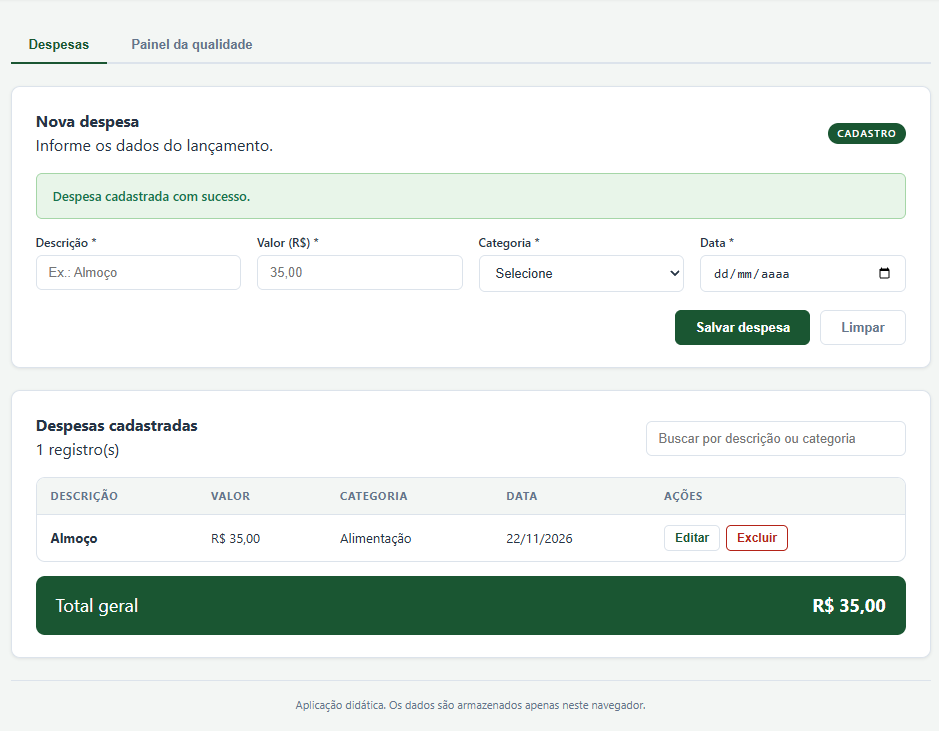
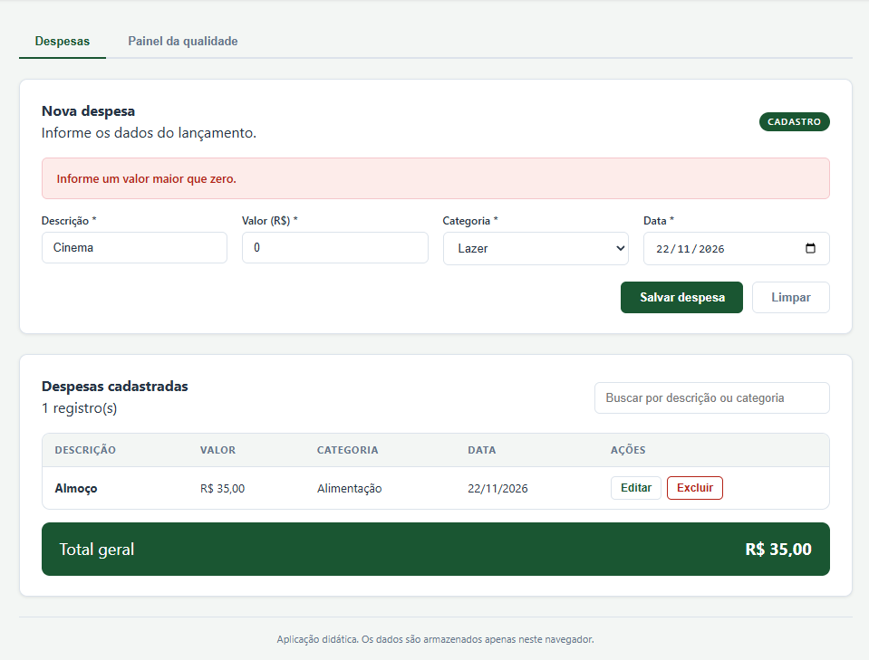
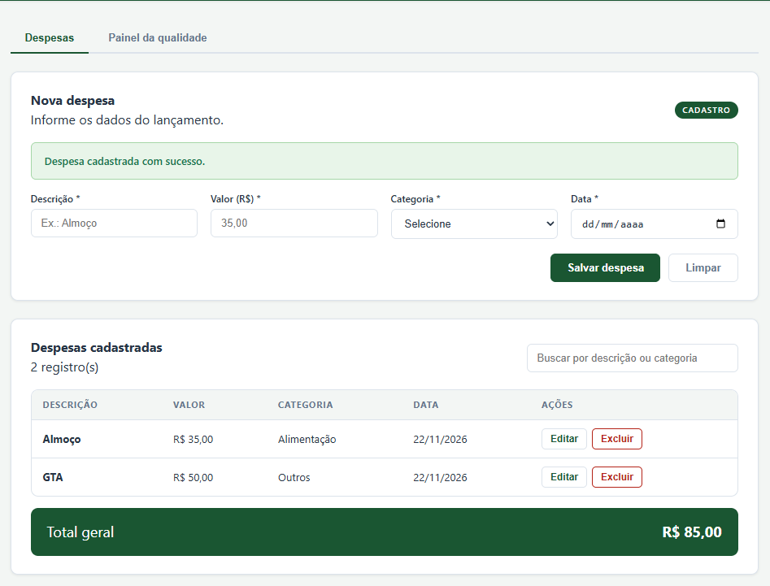
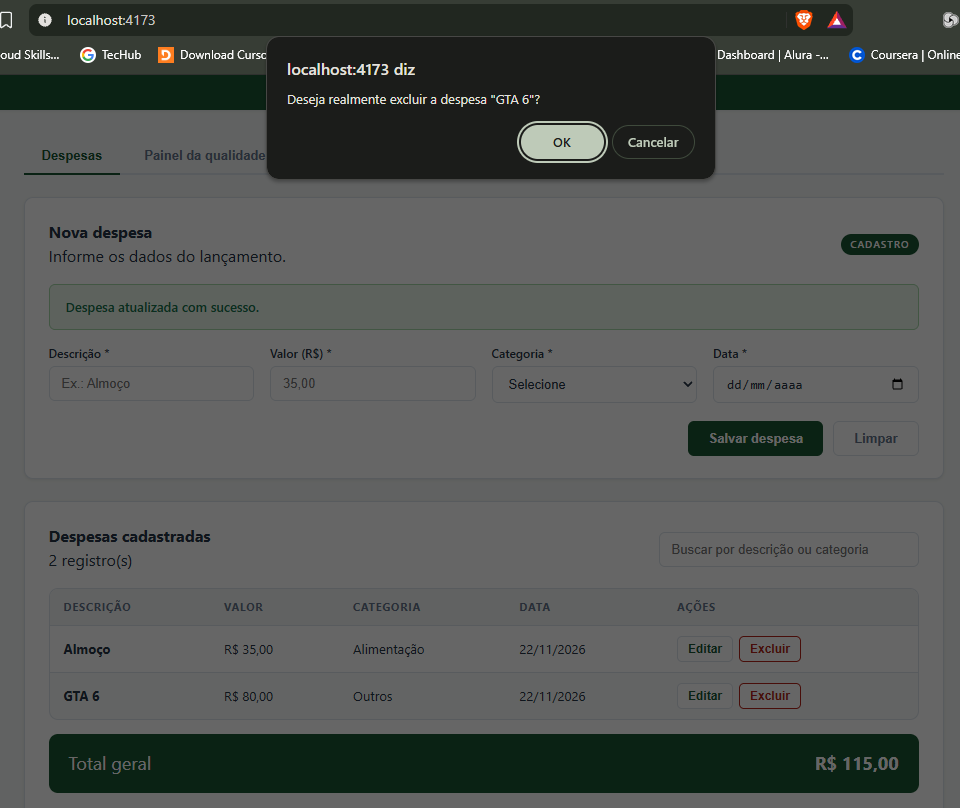
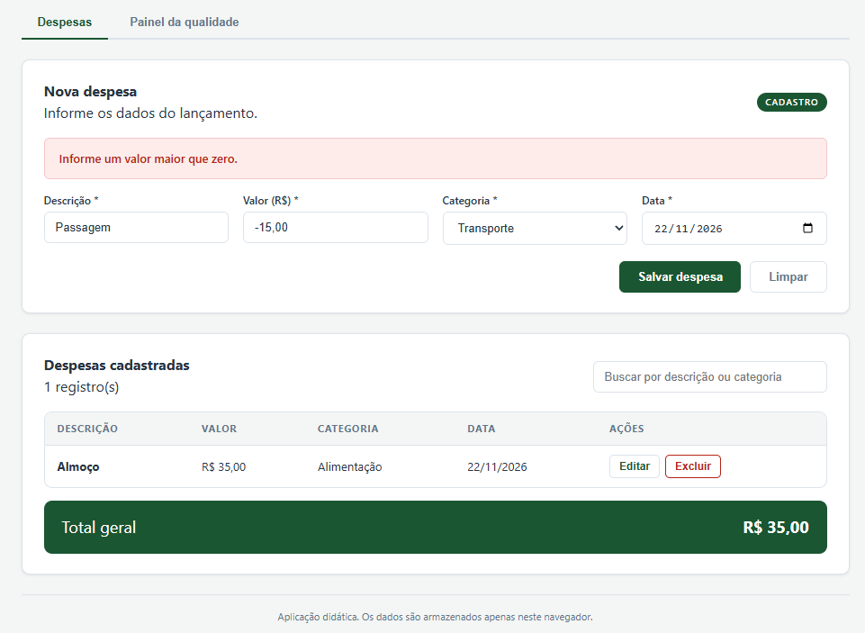

# Plano e Resultados dos Casos de Teste

> **Resumo da Execução:** Todos os 5 casos de teste foram executados no ambiente de testes (navegador web), validados e **aprovados**, com suas respectivas evidências de captura de tela registradas abaixo.

---

## Tabela de Resultados dos Casos de Teste

| ID | Cenário / Dados de Entrada | Resultado Esperado | Resultado Obtido | Status | Evidências |
|:---|:---|:---|:---|:---:|:---|
| **CT01** | Cadastrar "Almoço", R$ 35,00, Alimentação e data válida | Registro salvo e total atualizado | Registro salvo e total atualizado | **Aprovado** | [Evidência](evidencias/CT01_cadastro_sucesso.png) |
| **CT02** | Salvar com o valor em branco | Campo bloqueado e mensagem exibida | Bloqueado e mensagem exibida | **Aprovado** | [Evidência](evidencias/CT02_validacao_em_branco.png) |
| **CT03** | Editar uma despesa de R$ 50,00 para R$ 80,00 | Dados e total são recalculados | Dados e total recalculados | **Aprovado** | [Parte 1](evidencias/CT03_edicao_valor.png), [Parte 2](<evidencias/CT03_edicao_valor (2).png>) |
| **CT04** | Excluir uma despesa e confirmar | Registro removido e total recalculado | Item removido e total recalculado | **Aprovado** | [Parte 1](evidencias/CT04_exclusao_confirmada.png), [Parte 2](<evidencias/CT04_exclusao_confirmada (2).png>) |
| **CT05** | Regressão: cadastrar valor negativo após correção | Valor negativo rejeitado e valor positivo aceito | Validação rejeitou negativo e aceitou positivo | **Aprovado** | [Parte 1](evidencias/CT05_regressao_negativo.png), [Parte 2](<evidencias/CT05_regressao_negativo (2).png>) |

---

## Registro Detalhado de Evidências

### CT01 – Cadastro com Sucesso
* **Objetivo:** Validar o fluxo de inserção de despesa válida e atualização do somatório.
* **Status:** Aprovado.
* **Evidência:**

---

### CT02 – Validação de Campo Obrigatório em Branco
* **Objetivo:** Verificar se o sistema impede o salvamento sem o preenchimento do valor.
* **Status:** Aprovado.
* **Evidência:**

---

### CT03 – Edição de Despesa e Recálculo
* **Objetivo:** Validar o carregamento dos dados para edição, alteração do valor para R$ 80,00 e recálculo do total.
* **Status:** Aprovado.
* **Evidências (Etapa 1 e Etapa 2):**

.png>)

---

### CT04 – Exclusão com Confirmação
* **Objetivo:** Garantir a confirmação prévia e a remoção segura do registro com ajuste do totalizador.
* **Status:** Aprovado.
* **Evidências (Confirmação e Remoção):**

.png>)

---

### CT05 – Teste de Regressão (Não Conformidade NC01)
* **Objetivo:** Comprovar a eficácia da ação corretiva para a NC01, bloqueando valores negativos e aceitando o valor positivo corrigido.
* **Status:** Aprovado.
* **Evidências (Rejeição do Negativo e Aceitação do Positivo):**

.png>)
