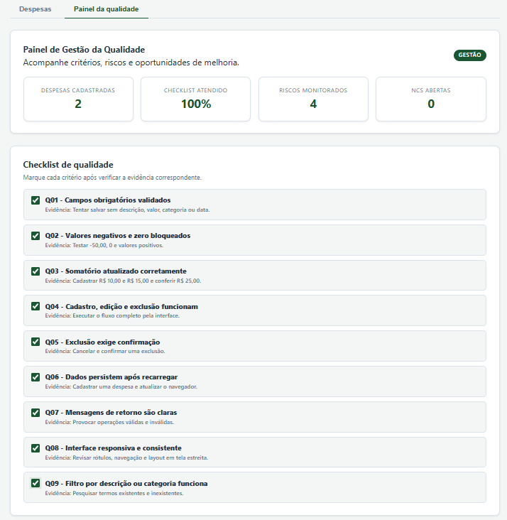

# Critérios e Checklist de Qualidade

> **Instruções de preenchimento:** para cada critério, marque o resultado como **Atende**, **Não atende** ou **Não aplicável (N/A)**.

---

## Checklist de Verificação

| ID   | Critério                                  | Como verificar                                                        | Evidência registrada                                                                 | Resultado |
|:-----|:------------------------------------------|:----------------------------------------------------------------------|:-------------------------------------------------------------------------------------|:---------:|
| Q01  | Campos obrigatórios validados             | Tentar salvar sem descrição, valor, categoria ou data                 | [CT02_validacao_em_branco.png](evidencias/CT02_validacao_em_branco.png)              | **Atende** |
| Q02  | Valores monetários validados              | Testar valor zero, negativo e texto                                   | [CT05 (Parte 1)](evidencias/CT05_regressao_negativo.png), [CT05 (Parte 2)](<evidencias/CT05_regressao_negativo (2).png>) | **Atende** |
| Q03  | Cálculo do totalizador correto            | Cadastrar despesas e comparar soma                                    | [Q03_totalizador_soma.png](evidencias/Q03_totalizador_soma.png)                      | **Atende** |
| Q04  | Operações principais disponíveis          | Cadastrar, editar, consultar e excluir                                | [CT01](evidencias/CT01_cadastro_sucesso.png), [CT03 (1 e 2)](evidencias/CT03_edicao_valor.png), [CT04 (1 e 2)](evidencias/CT04_exclusao_confirmada.png) | **Atende** |
| Q05  | Exclusão exige confirmação                | Cancelar e confirmar exclusão                                         | [CT04 (Diálogo e Confirmação)](evidencias/CT04_exclusao_confirmada.png)              | **Atende** |
| Q06  | Persistência funciona                     | Cadastrar e atualizar o navegador                                     | Persistência validada no LocalStorage ([Painel 100%](evidencias/PAINEL_conformidade_100.png)) | **Atende** |
| Q07  | Mensagens são claras                      | Provocar sucesso e erro                                               | Feedback sucesso ([CT01](evidencias/CT01_cadastro_sucesso.png)) e erro ([CT02](evidencias/CT02_validacao_em_branco.png)) | **Atende** |
| Q08  | Interface consistente                     | Revisar rótulos, botões e navegação                                   | Inspeção visual realizada ([Painel de Gestão](evidencias/PAINEL_conformidade_100.png))| **Atende** |
| Q09  | Filtro por categoria/descrição funciona   | Testar busca com diferentes termos                                    | [Q09 - Busca 1](evidencias/Q09_filtro_busca.png), [Q09 - Busca 2](<evidencias/Q09_filtro_busca (2).png>) | **Atende** |

---

## Indicador de Qualidade

$$
\text{Índice de Conformidade (\%)} = \frac{\text{Critérios Atendidos}}{\text{Total de Critérios Aplicáveis}} \times 100
$$

* **Critérios Atendidos:** 9
* **Total de Critérios Aplicáveis:** 9
* **Critérios Não Aplicáveis (N/A):** 0

$$
\text{Índice de Conformidade} = \frac{9}{9} \times 100 = \mathbf{100\%}
$$

---

## Evidência Consolidada do Painel da Qualidade

O sistema atingiu **100% de conformidade** em todos os critérios auditados, com riscos monitorados e não conformidades corrigidas:

